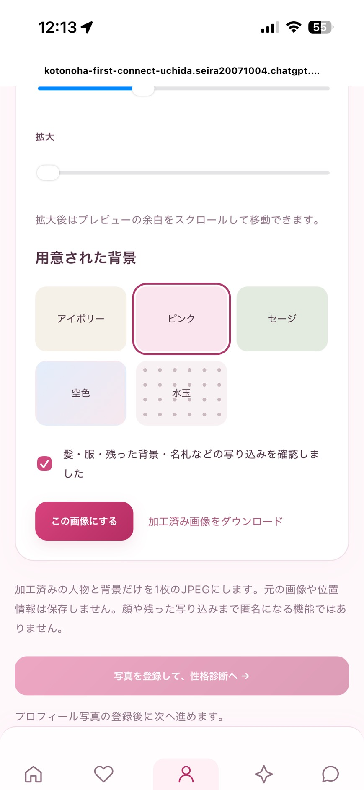
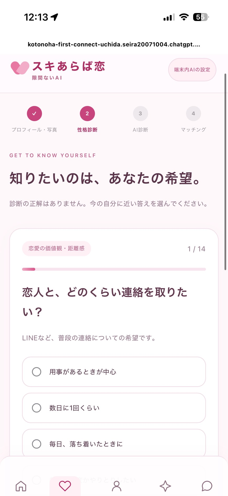
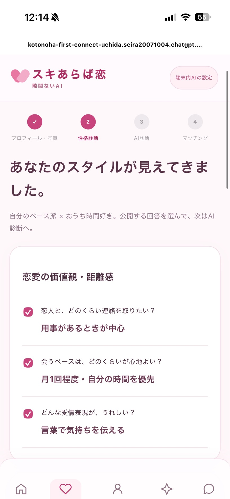
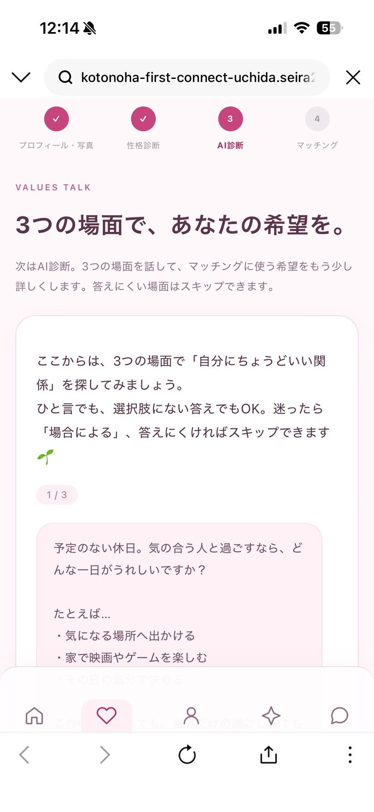
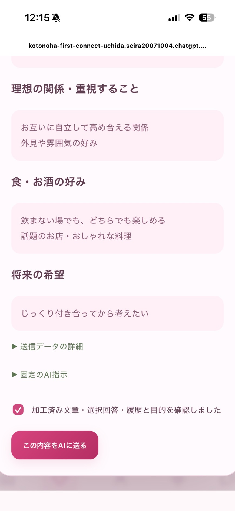
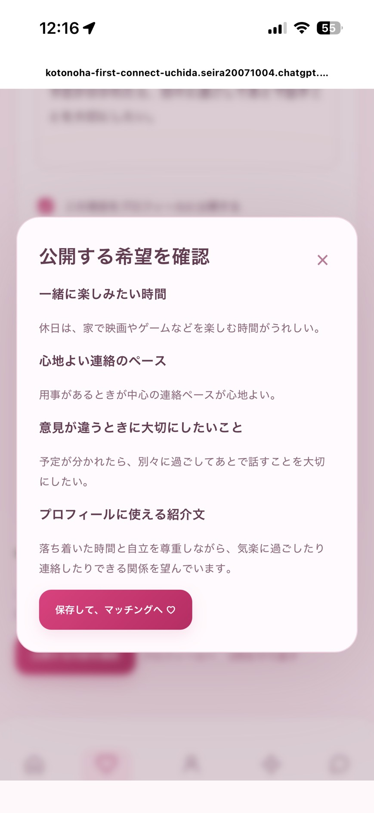

# スキあらば恋、隙間ないAI

**恋で舞い上がっても、個人情報まで送りすぎない。**

気になる人とマッチして、うれしくて、つい話しすぎる。
そんな瞬間に、送信前の警告と言い換え案でひと呼吸おける、個人情報保護を中心にしたマッチングアプリです。

[公開アプリ](https://kotonoha-first-connect-uchida.seira20071004.chatgpt.site/) · [デモ手順](docs/PRIVACY_DEMO.md) · [情報の取り扱いと制約](docs/TRUST_BOUNDARIES.md) · [開発用ソース](web)

## 解決したい課題

私たちの出発点は、**「かわいい子とマッチして舞い上がったとき、余計な個人情報まで送ってしまうのでは？」**という身近な疑問でした。

「もっと仲良くなりたい」「会話を盛り上げたい」と思うほど、本名、学校や勤務先、最寄り駅、いつもの行動予定などを、相手との関係が十分にできる前に伝えてしまう可能性があります。一つひとつは軽い雑談でも、組み合わせると生活圏や所属を絞り込む手がかりになります。

対象にしているのは、気になる相手との会話で、早く返信したい・自分のことを知ってほしいと感じる利用者です。性別にかかわらず、**「話したい気持ち」と「まだ知らせなくてよい情報」を分ける**ことを支援します。

この課題はチームの問題仮説です。発生頻度や、導入によって情報の送りすぎがどれだけ減るかは、今後の利用者検証で確かめます。

## 何ができるのか

本アプリ内のチャットで、送信前に端末内で個人情報の候補を確認します。修正が必要なら、その場で警告して言い換え案を入力欄へ戻します。**修正案を勝手に相手へ送らず、本人が確認・編集して、もう一度送信します。**

プロフィール写真も、端末内で背景を置き換え、写り込みを確認してから登録できます。文章と写真の両方で、相手に伝える情報を本人が選べることを大切にしています。

### 送信前に、こう変わる

以下は現在の標準チェックで確認した、合成した文章の例です。

| 入力した文章 | アプリの動作 |
| --- | --- |
| 「渋谷駅の近くに住んでいます。映画が好きです！」 | 生活圏の候補を検出。**この操作では送らず**、「駅の近くに住んでいます。映画が好きです!」を入力欄へ戻す |
| 修正案を本人が確認し、もう一度送信 | 最初から再確認し、追加の指摘がなければ相手へ送信 |
| 「映画を見て、感想を話せたらうれしいです！」 | 標準チェックで指摘がなければ、そのまま送信 |

会話の話題は残しながら、場所を特定する手がかりを減らします。ただし、言い換えによって意味や口調が変わる場合があるため、本人の確認を残しています。

## 特長と工夫

### 1. 「気をつけて」で終わらず、送信する瞬間に支える

注意事項を覚えてもらうだけでなく、実際の文章に対して警告と言い換え案を提示します。電話番号・メールアドレス・連絡先ID・住所や駅名・登録済みの氏名・所属や行動予定などをルールで確認します。これらは検出対象の例であり、すべての表現を検出できるわけではありません。

入力 → 確認 → 修正案 → 本人の編集 → 再確認、という操作をチャットの中で完結させます。通常の文章はモデルの準備なしで送信できます。

### 2. 個人情報を探すために、原文を外部AIへ渡さない

**端末内のルール・任意の端末内AIと、外部AIの役割を分けています。**

- **標準チェック：** 端末内のルールで確認します。WebGPUやAIモデルの準備は不要です。画面にも端末内AIを使用していないことを表示します。
- **端末内AIの追加チェック：** 対応端末で任意に有効化し、ルールが拾いにくい固有の店名や文脈に残る情報も追加で確認します。AI追加中に処理が失敗した場合は、その操作では送信せず、勝手に標準チェックへ切り替えません。
- **外部AIの文章補助：** 「ちょっとボケる」「会話を広げる」を本人が押し、加工済みの送信内容を確認・承認した場合に利用します。通常のチャット送信では外部AIを呼びません。

外部AIから返った候補も、選択中のチェックを通して入力欄へ戻します。候補を相手に送るかどうかは、最後まで本人が決めます。

### 3. 写真も、公開前に情報を減らす

人物を残して背景を置き換え、自宅・学校・生活圏などが写り込む機会を減らします。ブラシの「消す」「戻す」、取り消し、ブラシサイズ、拡大で範囲を調整し、背景を選んでプレビューできます。

元画像は背景加工のためにサーバーや外部AIへ送らず、本人が「この画像にする」を押した後、人物と背景を合成した画像だけを登録します。位置情報などの不要なメタデータを除去し、元背景を復元するための編集レイヤーをアップロードしません。

顔や名札、服の文字、切り抜きで残った背景などは識別の手がかりになり得ます。背景変更後も本人が写り込みを確認します。

### 4. 公開する範囲を、自分で決める

登録時には14問の選択式チェックと、3つの場面について話す「価値観トーク」で、休日の過ごし方や連絡のペースなどを整理します。回答や紹介文は編集でき、プロフィールに公開する項目を選べます。

価値観トークは外部AIを使う別の機能です。送信対象の加工済み回答・選択回答・履歴と目的を確認してから送ります。性格や恋愛の成功を断定するための診断としては扱いません。

## 情報はどこへ渡るのか

| 処理 | 端末内 | アプリのサーバー | 外部AI | 会話相手 |
| --- | --- | --- | --- | --- |
| 入力中の文章を確認 | ルールで検出。任意で端末内AIも使用 | 検出のために原文を追加送信しない | 検出目的では送らない | まだ送らない |
| 修正案を表示 | 入力欄へ戻し、本人が編集 | この段階では送らない | この段階では送らない | まだ送らない |
| 通常のチャット送信 | 選択中のチェックを通す | 認証とルールの再確認後に保存 | 呼び出さない | 確認を通った文章を受信 |
| 文章補助を選ぶ | 本人が加工済みの全文を確認 | 外部送信前に再確認 | 加工済みの1件と固定の編集指示を受信 | 候補ができても自動送信しない |
| 写真を加工・登録 | 元画像を加工し、本人が確認 | 確定した加工済み画像を保存 | 写真は送らない | 公開プロフィールの加工済み画像を表示 |

指摘がない文章は、入力文と送信文が同じになる場合があります。「すべての原文が端末外へ出ない」という設計ではありません。通常チャットの送信文や本人用の登録情報はアプリのサーバーが扱います。運営者からも情報を秘匿するE2E暗号化は実装していません。

端末内AIに渡す履歴は、加工した本人の直近4発言・各120文字までです。会話全体のあらゆる組み合わせを検証する仕組みではありません。モデル取得時には配信先との通信が発生します。

外部AIはResponses APIの `store:false` を指定しますが、外部事業者によるすべての保存を無効化する保証ではありません。[詳細な信頼境界](docs/TRUST_BOUNDARIES.md)も公開しています。

## 技術で工夫したこと

| 工夫 | 課題に対する意味 | 主な実装 |
| --- | --- | --- |
| 修正と送信許可を別の結果として扱う | 「加工できたから自動送信」を避け、確認する機会を残す | [trust-review.js](web/public/demo/trust-review.js) |
| AIには本文中の引用と種類を出させ、置換はアプリ側で行う | 存在しない引用や自由な置換指示を採用せず、重なる検出範囲もまとめて加工する | [local-findings.mjs](web/public/demo/local-findings.mjs) |
| サーバーでも個人情報のルールと登録氏名を再確認する | 画面側を通らないAPI送信にも、保存前・外部AI送信前の確認を設ける | [community.mjs](web/lib/community.mjs) / [gateway.mjs](web/lib/ai/gateway.mjs) |
| 外部AIの候補にも再確認と本人の選択を設ける | AIが生成した文章を、そのまま相手へ流さない | [conversation-upgrade.js](web/public/demo/conversation-upgrade.js) |
| 写真の加工と書き出しを端末内で行う | 背景を含む元画像を加工サービスへ渡さずに、公開する画像を作る | [background-photo.js](web/public/demo/background-photo.js) / [photo-detection.js](web/public/demo/photo-detection.js) |

サーバーの形式・バージョン確認は、端末内AIが実行された証明にはなりません。改変されたクライアントからの通信に対して、サーバー側で強制できるのはルールと登録情報による確認です。

### 使用技術

- 画面・アプリ：JavaScript / TypeScript、Vinext
- サーバー・保存：Cloudflare Workers / D1 / R2、Drizzle
- 端末内AI：WebLLM / WebGPU（任意の追加チェック）
- 写真処理：MediaPipe、Tesseract.js、Canvas
- 外部AI：OpenAI Responses API
- 検証：Node.js標準テストランナー、SQLiteを用いたAPI・権限制御のテスト

[外部コンポーネント](web/THIRD_PARTY.md) / [実装の詳細](web/README.md)

## 登録から利用まで

1. 基本情報を入力し、公開名と本人用の情報を分けて登録する。
2. 写真の背景を変更し、写り込みを確認して画像を確定する。
3. 14問に回答し、公開する回答を選ぶ。
4. 価値観トークの送信内容を確認し、3つの場面について希望を整理する。
5. 結果を編集し、公開する項目を確認してマッチングへ進む。
6. マッチした相手とのチャットで、送信前のプライバシー確認を利用する。

<details>
<summary>登録画面を見る（提供されたスクリーンショットを操作順に掲載）</summary>

以下は初期登録の操作例です。チャットの送信前警告は、続くデモ手順で確認できます。

| ① 写真の写り込みを確認・確定 | ② 選択式チェックに回答 |
| --- | --- |
|  |  |

| ③ 公開する回答を選ぶ | ④ 3つの場面で希望を話す |
| --- | --- |
|  |  |

| ⑤ 外部AIへ送る内容を確認 | ⑥ 公開する紹介文・希望を最終確認 |
| --- | --- |
|  |  |

</details>

## デモで確認してほしいこと

**「修正案が出る」だけでなく、「修正案を確認するまで相手へ送られない」こと**を確認してください。

| 確認する場面 | 期待する動作 |
| --- | --- |
| 個人情報候補のない普通の会話 | 標準チェックで、そのまま送信できる |
| 駅名などを含む文章の送信 | 警告と修正案が出る。この操作では相手に届かない |
| 修正案を本人が編集して再送 | 再び確認し、候補が残れば再度修正を案内する |
| 端末内AI追加中にモデルが使えない | その操作では送信せず、設定の見直しを案内する |
| 外部AIによる文章補助 | 本人の確認後に外部送信し、返った候補は入力欄に戻る |
| 写真の背景変更 | 確定前に編集でき、確定した合成画像だけを登録する |

[入力例・操作・確認方法をまとめたデモ手順](docs/PRIVACY_DEMO.md)を用意しています。実在する個人の連絡先や住所を使う必要はありません。

## 検証結果と、まだ確かめる必要があること

本ブランチで `npm test` を実行し、**85件成功・失敗0件**を確認しました。これはロジックとAPIの自動テストの結果であり、実際の利用者への効果や、全端末での動作を実証した数値ではありません。

- [送信前確認のテスト](web/tests/trust-review.test.mjs)：修正時の停止、修正文の再確認、標準チェック、AI追加中の失敗、AIの不正な引用や重なる範囲の処理。
- [外部送信前のテスト](web/tests/trust-server.test.mjs)：個人情報候補を含む文章や古い形式を拒否し、原文やキーをエラーへ含めないこと。
- その他、プロフィールの公開範囲、写真のメタデータ除去、会話へのアクセス制御、ブロック後の拒否などを確認しています。

次の段階では、合成した会話シナリオを使い、警告がある場合とない場合で、不要な情報を送ろうとする行動がどう変わるかを検証します。見落とし・誤検出、修正後の意味の維持、警告の分かりやすさ、送信までの手間を測り、ルールと画面を改善します。実利用者による効果検証の結果は、取得後に追記します。

## JPHACKSの審査観点と、本READMEで示すこと

| 観点 | 本プロダクトの説明・確認箇所 |
| --- | --- |
| 問題着眼点・着想点 | 恋愛の高揚で情報を送りすぎる可能性に着目し、注意喚起を送信直前の具体的な修正支援へつなげる |
| 実行・実現可能性 | 想定利用者と利用場面を示し、モデルが使えない端末でも標準チェックを利用できる構成にする。情報の行き先と運用上の制約も明記する |
| 完成度・動作性 | 入力から警告・編集・再確認までのデモ手順、実装へのリンク、自動テスト結果を提示する。利用者への効果は今後の検証として区別する |

この整理は、確認できた[JPHACKS公式の公開審査基準（2021年版）](https://jphacks.github.io/2021-guideline/criteria/)を参考にしています。2026年の詳細基準と同一とは断定せず、提出時は[2026年公式案内](https://jphacks.com/2026/detail/)と参加者向けの最新案内を優先してください。採点結果を保証するものではありません。

開発差分は[本ブランチのコミット履歴](https://github.com/jphacks/ng_2608/commits/codex/chat-send-humor-fix/)で確認できます。開催期間内の成果と事前開発の区分は、実際の参加期間に基づいて提出時に示す必要があります。

## 起動方法

Node.js 22.13以降を使用します。

```sh
git clone --branch codex/chat-send-humor-fix git@github.com:jphacks/ng_2608.git
cd ng_2608/web
npm ci
npm run dev:local
```

表示された `http://127.0.0.1:5173` を開きます。これは起動したPC自身で開くアドレスです。

APIキーなしでもプロフィール・写真・14問と端末内のルール処理を確認できます。現在の画面では、マッチングの利用に価値観トークの完了が必要です。外部AIを含む一連の操作には、[開発環境の設定手順](docs/GETTING_STARTED.md)に従ってキーとモデルを設定してください。端末内AIには、モデルの準備と対応するWebGPU環境が別途必要です。

公開版で友達と試す場合は、各自の別アカウントで登録を完了し、「さがす」→「友達を招待する」からリンクを共有します。相手の同意後に会話できます。[2利用者での確認方法](web/README.md#スマホ同士で友達と話す)を参照してください。

```sh
# web/ で実行
npm test
```

[共同開発](CONTRIBUTING.md) · [テスト手順](docs/TESTING.md) · [デプロイ手順](docs/DEPLOYMENT.md)

## 制約と今後の改善

完全な匿名化や、個人情報の見落としゼロを保証するものではありません。標準チェックでは未知の文脈をAIで判断しません。端末内AIを追加しても誤検出・見落としがあり、写真の顔や残った文字から特定される可能性も残ります。

相手の信頼性や安全な交際を保証する機能ではありません。年齢は自己申告で、通報は記録できますが、専任の即時対応運用は未提供です。

今後は、日本語表現や複数発言の組み合わせに対する検証、スマホでのモデル準備・処理負荷の改善、本人確認・年齢確認・通報対応の整備を進めます。**情報を減らして会話を続けられることと、その限界を正しく伝えることの両方を、信頼の土台にします。**
