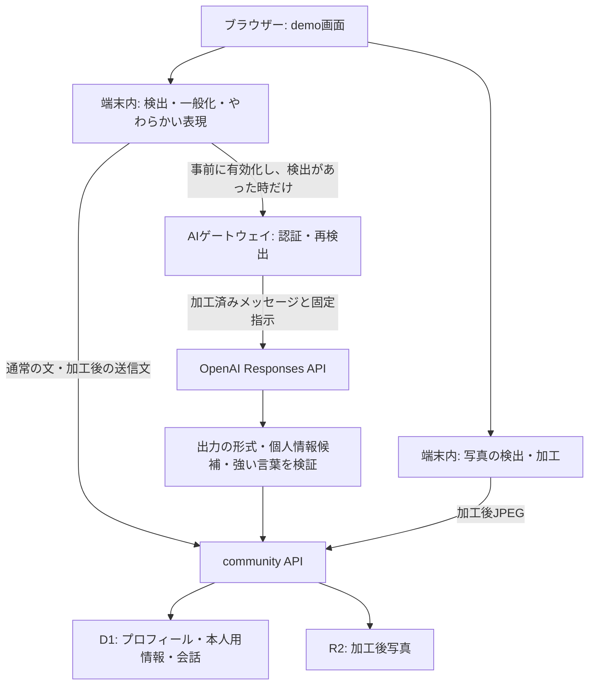

> 最新の登録順序・会話相性は [アプリREADMEの更新仕様](../web/README.md#登録フローと会話相性の更新) を参照してください。以下には従来の手動ヒント機能などの説明も含まれます。

# 実装と担当ファイル

## 現在のユーザーフロー

1. 基本情報：表示名、非公開の氏名、年齢、任意の活動エリア・職業・年収帯、知り合い方の希望、AI補助の設定。
2. 写真：端末内で文字と顔の候補を検出し、隠す案を適用。問題候補がある時だけ注意。写真は後で登録する選択も可能。
3. 価値観：6分野14問。回答を整理し、公開する項目を選んでプロフィールを保存。
4. 相手探し：公開された回答の一致・違いを相性として表示。
5. 相互の関心でマッチ成立。通常の文はそのまま送信、検出時だけ自動調整し、任意で変更内容を確認。

現在のメイン体験は選択式質問です。旧来の3回の自由会話や3軸のコードは互換のため残っており、現在の入口とは区別してください。
タイプやタグは回答の要約で、心理検査ではありません。

## 全体構成



AIが失敗・タイムアウト・出力確認に失敗した場合、自動チャット補助は端末内の加工結果を使います。
原文を代替送信する処理にはしません。出力の再確認にも通らない場合は送信を止めて通知します。
この検証はパターンに基づき、意味が完全に保たれる保証ではありません。

## 画面の構成と読み込み順

メイン画面はReactコンポーネントではなく `web/public/demo/` のHTML・CSS・JavaScriptです。
VinextはAPI・認証・ホスティング部分を担当し、`app/page.tsx` はデモ画面に移動します。

読み込み順は `index.html` で定義します：

```text
privacy → support → questionnaire → domain → photo-detection → photo
→ app → questionnaire-ui → experience
```

`app.js` の画面関数やイベントは、後から読み込むファイルで上書きされます。
たとえば自動送信の入口は `experience.js` の `sendSmartChat` です。
古い `reviewChat` だけを編集しても現在の送信UXには反映されない場合があります。
グローバルな状態 `s` と関数上書きへの依存を減らすことは今後の整理候補です。

| 変更したいところ | 主なファイル（すべて `web/` 以下） |
| --- | --- |
| 基本情報・写真→質問の順序、自動送信、設定画面 | `public/demo/experience.js` |
| ピンクの見た目・レスポンシブ | `public/demo/pink.css`、共通の `style.css` |
| 基本画面、相手一覧、会話読み込み・状態 | `public/demo/app.js` |
| 個人情報の検出・AI入出力の定義 | `public/demo/privacy.js` |
| 氏名・収入・強い言葉の自動変換、写真警告条件 | `public/demo/support.js` |
| 14問・選択肢・相性計算 | `public/demo/questionnaire.js` |
| 質問画面・公開項目の選択 | `public/demo/questionnaire-ui.js` |
| 旧3軸などの互換ロジック | `public/demo/domain.js` |
| 顔・文字の端末内検出 | `public/demo/photo-detection.js` |
| マスキング、候補変更、画像の書き出し | `public/demo/photo.js` |
| AIの認証・同意・送信・出力検証 | `lib/ai/gateway.mjs`、`app/api/ai/` |
| 保存・相互マッチ・アクセス制御 | `lib/community.mjs`、`app/api/community/` |
| 公開環境の認証情報取得 | `app/chatgpt-auth.ts` |
| データ構造・移行 | `db/schema.ts`、`drizzle/` |
| APIキー不要のローカルサーバーと保存 | `scripts/local-demo.mjs`、`scripts/local-storage.mjs` |

## 情報の保存先

| データ | 保存・表示の扱い |
| --- | --- |
| 表示名・年齢・希望・公開回答・公開エリア/職業 | `profiles`。他の利用者向けAPIにも含む |
| 氏名・年収帯・年収公開設定・AI補助設定 | `account_details`。本人の `basics` だけが返す |
| 公開を選んだ年収帯 | `profiles` にも反映。初期設定は空 |
| 関心・会話・ブロック・通報 | `likes`、`messages`、`blocks`、`reports` |
| AI日次回数 | `ai_usage`。日付はUTC、上限60回。登録削除でリセットしない |
| 加工後の写真 | R2。ローカルでは `.sites-runtime/local-photos/` |
| 変更を見る用の入力原文と加工後の文 | ブラウザーのタブ内メモリー。変更記録として永続保存しない |
| AIに渡す加工済み内容の送信記録 | ブラウザーのメモリー。サーバーで本文ログを保存しない |

氏名などはアプリ独自の暗号化をしていません。「非公開」は他の利用者向け応答に出さないという意味で、運営者から秘匿する保証ではありません。
APIキーは別のサーバー秘密変数であり、プロフィールのDBには入れません。

## 相性の計算

基本重み：恋愛スタイル30、ライフスタイル20、コミュニケーション15、理想の関係15、食10、将来10。
両者の公開回答と一致を重視する度合いを使い、共通回答が7項目かつ3分野以上ある場合だけ総合点を表示します。
未回答・非公開を中間値で埋めません。年収・氏名は採点しません。
20歳未満には飲酒を希望する回答を表示せず、サーバーでも拒否します。
重みは仮の製品ルールです。マッチ成立・交際成功の確率ではありません。

## APIの入口

すべて同じサイトのOriginを使います。公開版の本人情報はホストの認証から取り、リクエスト本文の利用者IDを本人の根拠にはしません。

| メソッド・パス | 用途 |
| --- | --- |
| `GET /api/ai/config` | 認証・AI設定の利用可否 |
| `POST /api/ai/respond` | 検証済みの加工済み入力からAI応答 |
| `GET/POST /api/community/basics` | 本人用の登録情報・公開基本情報 |
| `GET /api/community/me`、`POST /api/community/profile` | 公開プロフィール取得・保存 |
| `GET /api/community/profiles` | ブロックを除く相手一覧（最大100件） |
| `POST /api/community/like`、`GET /api/community/chats` | 関心と相互マッチ |
| `GET /api/community/messages?peer=…`、`POST /api/community/message` | 相互マッチ済み相手との会話（取得は最大100件、本文は1,000文字まで） |
| `GET/PUT/DELETE /api/community/photo` | 加工後JPEGの取得・保存・削除 |
| `POST /api/community/block`、`GET /api/community/blocks` | ブロックと解除（POSTの `blocked` をtrue/falseにする） |
| `POST /api/community/report` | 通報の受付記録 |
| `DELETE /api/community/me` | 本人の登録と関連会話などの削除 |

厳密な入力形・エラーは `lib/community.mjs` / `lib/ai/gateway.mjs` とテストを正とします。
`approved: true` という値だけで本人の同意を保証するものではありません。
AIの `automatic` リクエストでは、サーバーが保存済みの `ai_assist` 設定も確認します。

## 境界と既知の制約

- 個人情報・NGワードの検出はルールと辞書です。すべての言い回し、伏字、他の発言との組み合わせを検出する機能ではありません。
- チャットの自動変換はブラウザーの処理です。`message` APIは同じマスキングを強制せず、直接のAPI呼び出しを通じた未加工送信まで防ぐ実装ではありません。
- AIゲートウェイは送信前に個人情報候補と登録氏名を再確認しますが、検出しない識別情報が残る可能性があります。加工前の文を送る設計ではなく、完全匿名化の保証でもありません。
- 写真は文字・顔の候補を検出します。最も大きい顔を残す案であり、本人の顔の識別ではありません。ランドマークや背景の意味から所在地を特定する機能は未実装です。
- 登録された氏名・年齢は自己申告です。本人確認済みを表すものではありません。
- 通報は記録のみで、専任の監視・即時対応はありません。
- チャットの開示ヒントは読み込んだ直近100件が対象です。履歴全体の再識別リスク計算は未実装です。
